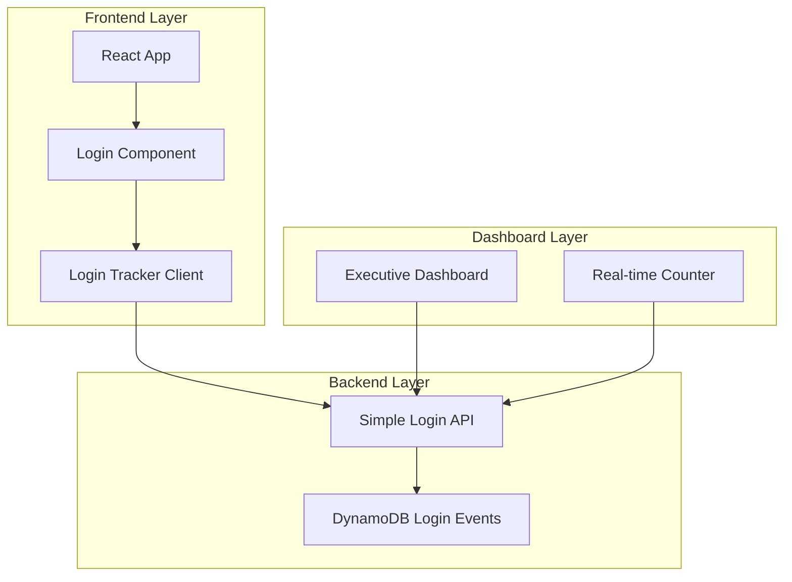

# Login Tracker System Design Document

## Overview

The Login Tracker system is designed to provide lightweight monitoring and reporting of user authentication events in the EV Digital Twin Tire Maintenance System. The primary focus is capturing successful logins for leadership reporting and demo showcasing.

The system follows a simple, lightweight architecture that integrates seamlessly with the existing AWS Amplify authentication without adding complexity. It captures essential login events, stores them efficiently, and provides clean executive dashboards for leadership presentations.

## Architecture

### Lightweight Architecture



### Simple Integration

The Login Tracker integrates with the current AWS Amplify authentication system by:

1. **Simple Event Hook**: Adds a single line to capture successful logins
2. **Fire-and-Forget**: Sends login events asynchronously without blocking authentication
3. **Minimal Footprint**: No complex processing or monitoring - just basic counting
4. **Development Mode**: Handles bypassed authentication gracefully

## Components and Interfaces

### 1. Frontend Components

#### Simple Login Tracker (`src/services/loginTracker.js`)
- **Purpose**: Capture successful logins only
- **Responsibilities**:
  - Hook into successful Amplify authentication
  - Send basic login event (username, timestamp)
  - Fire-and-forget approach - no complex error handling
- **Interface**:
  ```javascript
  const trackLogin = (username) => {
    // Simple POST to API
  }
  ```

#### Executive Dashboard Component (`src/components/LoginStats.js`)
- **Purpose**: Display simple login metrics for leadership
- **Responsibilities**:
  - Show total login count
  - Display daily/weekly active users
  - Simple, clean executive-friendly display
- **Interface**:
  ```javascript
  const LoginStats = () => {
    // Simple metrics display
  }
  ```

### 2. Backend Services

#### Single Login API Lambda
- **Purpose**: Store login events and provide basic metrics
- **Responsibilities**:
  - Store successful login events
  - Calculate simple aggregations (total, daily, weekly)
  - Return metrics for dashboard
- **Endpoints**:
  - `POST /login` - Record successful login
  - `GET /stats` - Get basic login statistics

## Data Models

### Simple Login Event Model
```json
{
  "loginId": "uuid",
  "timestamp": "ISO8601",
  "username": "string",
  "date": "YYYY-MM-DD"
}
```

### Basic Stats Model
```json
{
  "totalLogins": "number",
  "todayLogins": "number",
  "weekLogins": "number",
  "monthLogins": "number",
  "uniqueUsers": "number",
  "lastUpdated": "ISO8601"
}
```

## Correctness Properties

*A property is a characteristic or behavior that should hold true across all valid executions of a system-essentially, a formal statement about what the system should do. Properties serve as the bridge between human-readable specifications and machine-verifiable correctness guarantees.*

### Property Reflection

After reviewing all properties identified in the prework analysis, I've identified several areas where properties can be consolidated to eliminate redundancy:

**Consolidation Areas:**
1. **Event Recording Properties (1.1, 1.2, 1.3)**: These can be combined into a comprehensive event recording property that covers all event types
2. **Analytics Display Properties (2.1, 2.2, 2.3, 2.4)**: These can be consolidated into a single analytics accuracy property
3. **Data Storage Properties (3.1, 3.2)**: These overlap significantly and can be combined
4. **Security Detection Properties (4.1, 4.2, 4.3)**: These follow the same pattern and can be unified
5. **Executive Dashboard Properties (6.1, 6.2, 6.4)**: These are all about dashboard display and can be combined

**Retained Separate Properties:**
- Session lifecycle tracking (1.4) - unique functionality
- Data retrieval and filtering (3.4, 2.5) - distinct from storage
- Error handling and resilience (3.3, 5.3) - critical fault tolerance
- Integration compatibility (5.1, 5.4) - specific to Amplify integration
- Performance requirements (5.2) - distinct performance concern
- Development mode handling (5.5) - special case handling
- Data retention (3.5) - lifecycle management
- Alert generation (4.4) - distinct from detection
- Baseline maintenance (4.5) - ongoing analysis requirement
- Report generation (6.3) - export functionality
- Leadership presentation (6.5) - formatting requirement

### Simplified Properties

**Property 1: Login Event Recording**
*For any* successful authentication, the system should record the username and timestamp
**Validates: Requirements 1.2, 3.1, 3.2**

**Property 2: Basic Statistics Accuracy**
*For any* set of stored login events, the basic counts (total, daily, weekly, monthly, unique users) should accurately reflect the stored data
**Validates: Requirements 2.1, 6.1, 6.2**

**Property 3: Non-Blocking Integration**
*For any* authentication flow, the login tracker should not block or slow down the authentication process
**Validates: Requirements 5.1, 5.2, 5.3**

**Property 4: Development Mode Compatibility**
*For any* development environment, the login tracker should handle bypassed authentication without errors
**Validates: Requirements 5.5**

**Property 5: Dashboard Data Accuracy**
*For any* dashboard request, the displayed metrics should match the current stored login data
**Validates: Requirements 6.4, 6.5**

## Error Handling

### Simple Error Handling
- **API Failures**: Log error and continue - don't block authentication
- **Network Issues**: Fire-and-forget approach - if it fails, it fails
- **Invalid Data**: Basic validation, use defaults if needed

### Minimal Monitoring
- **Basic CloudWatch Logs**: Simple logging for debugging
- **No Complex Alerting**: Keep it simple - check logs if needed

## Testing Strategy

### Lightweight Testing Approach

**Unit Testing**:
- Test basic login event recording
- Verify simple statistics calculations
- Test dashboard component with sample data
- Basic API endpoint testing

**Property-Based Testing**:
- Use **fast-check** (JavaScript) for simple property tests
- Configure each property test to run a minimum of 100 iterations
- Each property-based test will be tagged with the format: **Feature: login-tracker, Property {number}: {property_text}**

**Simple Integration Testing**:
- Test login tracking doesn't break authentication
- Verify dashboard shows correct counts
- Basic end-to-end flow testing