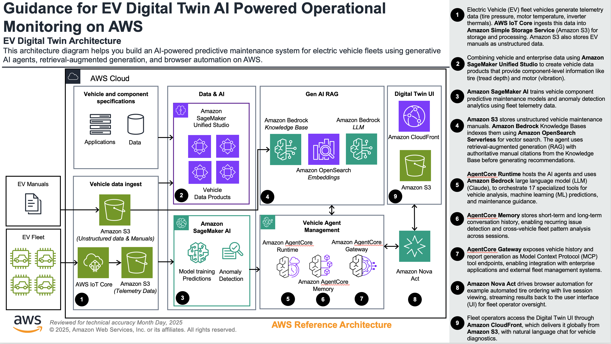
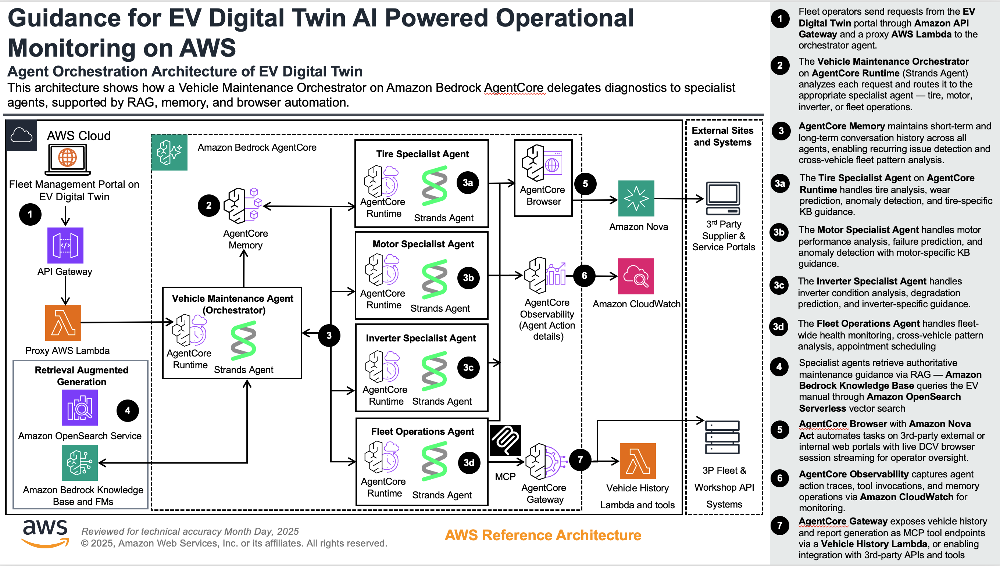

# Guidance for EV Digital Twin on AWS powered by GenAI

This guidance illustrates how to build an AI-powered predictive maintenance system for electric vehicle fleets using generative AI agents, retrieval-augmented generation, and browser automation on AWS.

## Table of Contents

1. [Overview](#overview)
    - [Architecture](#architecture)
    - [Cost](#cost)
2. [Prerequisites](#prerequisites)
    - [Operating System](#operating-system)
    - [Third-party Tools](#third-party-tools)
    - [AWS Account Requirements](#aws-account-requirements)
    - [Supported Regions](#supported-regions)
3. [Deployment Steps](#deployment-steps)
4. [Deployment Validation](#deployment-validation)
5. [Running the Guidance](#running-the-guidance)
6. [Next Steps](#next-steps)
7. [Cleanup](#cleanup)
8. [FAQ, Known Issues, Additional Considerations, and Limitations](#faq-known-issues-additional-considerations-and-limitations)
9. [Revisions](#revisions)
10. [Notices](#notices)
11. [Authors](#authors)

## Overview

Electric vehicle fleets generate large volumes of sensor telemetry across tires, motors, and inverters. Manually analyzing this data to predict failures, schedule maintenance, and order replacement parts is time-consuming and error-prone. This Guidance demonstrates how to build an AI-powered digital twin system that combines machine learning predictive analytics with generative AI agents to deliver intelligent, automated vehicle maintenance management.

The solution uses Amazon Bedrock AgentCore with a multi-agent orchestrator architecture. A lightweight orchestrator agent classifies user intent and routes to four specialist agents — Tire, Motor, Inverter, and Fleet Operations — each on its own AgentCore Runtime with domain-specific tools and system prompts. The 17 specialized tools span real-time vehicle analysis, ML-based predictions, Knowledge Base retrieval (RAG), appointment scheduling, and automated tire ordering via browser automation. AgentCore Memory enables recurring issue detection and cross-vehicle fleet pattern analysis across sessions.

### Key Capabilities

- **Predictive Maintenance**: Random Forest and Isolation Forest models forecast tire wear, motor failures, and inverter thermal issues up to 90 days ahead
- **Retrieval-Augmented Generation (RAG)**: Agent retrieves authoritative guidance from vehicle maintenance manuals via Amazon Bedrock Knowledge Bases with OpenSearch Serverless vector search before generating recommendations
- **Browser Automation**: Amazon Nova Act automates tire ordering from Amazon.com with live session viewing streamed back to the fleet operator UI
- **Multi-Agent Orchestration**: Strands Agents on AgentCore Runtime with an orchestrator routing to domain-specific specialist agents
- **Memory-Powered Insights**: AgentCore Memory (short-term + long-term) detects recurring issues and fleet-wide patterns across sessions
- **Fleet Management**: Unified dashboard monitors tire, motor, and inverter health across the entire vehicle fleet

### Architecture





#### Architecture Data Flow

1. **EV fleet** vehicles generate telemetry data (tire pressure, motor temperature, inverter thermals) ingested through **AWS IoT Core** into **Amazon S3** for storage and processing.
2. Sample EV data products provide component-level telemetry — tire (pressure, tread depth, temperature), motor (RPM, oil pressure, vibration), and inverter (voltage, current, efficiency, thermals) — which feed into **Amazon SageMaker AI** for training predictive maintenance and anomaly detection models.
3. Unstructured vehicle maintenance manuals stored in **Amazon S3** are indexed by **Amazon Bedrock** Knowledge Bases using Titan embeddings and **Amazon OpenSearch Serverless** for hybrid vector and keyword search.
4. **AgentCore Runtime** hosts a multi-agent orchestrator powered by **Amazon Bedrock** LLM (Claude). The orchestrator routes queries to four specialist agents — Tire, Motor, Inverter, and Fleet Operations — each with domain-specific tools for vehicle analysis, ML predictions, and maintenance guidance.
5. The agent uses retrieval-augmented generation (RAG) to combine real-time sensor analysis with authoritative manual citations from the Knowledge Base before generating recommendations.
6. **AgentCore Memory** stores short-term and long-term conversation history, enabling recurring issue detection and cross-vehicle fleet pattern analysis across sessions.
7. **AgentCore Gateway** exposes vehicle history and report generation as MCP tool endpoints, enabling integration with enterprise applications and external fleet management systems.
8. Users access the Digital Twin UI — a React application hosted on **Amazon S3** and delivered globally through **Amazon CloudFront** — with natural language chat for vehicle diagnostics and maintenance scheduling.
9. Browser automation via **Amazon Nova Act** enables automated tire ordering with live session viewing, streamed back to the UI for fleet operator oversight.

### AWS Services Used

| AWS Service | Purpose |
|---|---|
| Amazon Bedrock (AgentCore Runtime) | AI agent hosting with Strands Agent framework and Claude Sonnet 4.5 |
| Amazon Bedrock (AgentCore Memory) | Short-term and long-term conversation memory for pattern detection |
| Amazon Bedrock (AgentCore Gateway) | MCP endpoint for vehicle history and report tools |
| Amazon Bedrock (Knowledge Bases) | RAG retrieval from vehicle maintenance manuals |
| Amazon OpenSearch Serverless | Vector store for Knowledge Base embeddings |
| Amazon S3 | Frontend hosting, manual document storage, browser session recordings |
| Amazon CloudFront | Global content delivery for the React frontend |
| AWS WAF | Web application firewall protecting CloudFront distribution |
| Amazon API Gateway | REST API endpoints for frontend-to-agent communication |
| AWS Lambda | Proxy Lambda (agent routing), Worker Lambda (async tire ordering), Vehicle History Lambda, Gateway Proxy Lambda |
| Amazon DynamoDB | Appointment scheduling, async job tracking, cached AI recommendations |
| Amazon Cognito | User authentication with admin-only registration |
| Amazon ECR | Container registry for AgentCore Runtime Docker images |
| AWS Secrets Manager | Secure storage for NovaAct API key |
| Amazon CloudWatch | Logging and monitoring across all services |
| AWS CloudFormation | Infrastructure as Code for all stacks |

### Cost

_You are responsible for the cost of the AWS services used while running this Guidance. As of March 2026, the cost for running this Guidance with the default settings in the US East (N. Virginia) Region is approximately $150–250 per month for a development/demo workload processing approximately 1,000 agent interactions._

The primary cost drivers are Amazon Bedrock model invocations (Claude Sonnet 4.5), OpenSearch Serverless for the Knowledge Base vector store, and AgentCore Runtime compute. Browser automation (Nova Act) incurs additional per-session costs when tire ordering is triggered.

_We recommend creating a [Budget](https://docs.aws.amazon.com/cost-management/latest/userguide/budgets-managing-costs.html) through [AWS Cost Explorer](https://aws.amazon.com/aws-cost-management/aws-cost-explorer/) to help manage costs. Prices are subject to change. For full details, refer to the pricing webpage for each AWS service used in this Guidance._

#### Sample Cost Table

The following table provides a sample cost breakdown for deploying this Guidance with the default parameters in the US East (N. Virginia) Region for one month.

| AWS Service | Dimensions | Cost [USD] |
|---|---|---|
| Amazon Bedrock (Claude Sonnet 4.5) | ~1,000 agent interactions, ~500K input + 200K output tokens | ~$75.00/month |
| Amazon OpenSearch Serverless | 2 OCUs (indexing + search) for Knowledge Base | ~$50.00/month |
| Amazon Bedrock (Titan Embeddings) | ~10K embedding requests for KB indexing/queries | ~$1.00/month |
| Amazon S3 | Frontend hosting + manual storage (~1 GB) | ~$0.03/month |
| Amazon CloudFront | ~10 GB data transfer, 100K requests | ~$1.50/month |
| AWS WAF | 1 Web ACL, 6 managed rules, ~100K requests | ~$11.00/month |
| Amazon API Gateway | ~10,000 REST API calls | ~$0.04/month |
| AWS Lambda | 4 functions, ~10,000 invocations, 256 MB memory | ~$0.50/month |
| Amazon DynamoDB | 3 tables, on-demand capacity, ~5K read/write units | ~$1.50/month |
| Amazon Cognito | <50 active users (free tier) | $0.00/month |
| Amazon ECR | 1 repository, ~2 GB storage | ~$0.20/month |
| AWS Secrets Manager | 1 secret, ~100 API calls | ~$0.40/month |
| Amazon CloudWatch | Logs and metrics across all services | ~$3.00/month |

**Estimated Total: ~$144/month** (excluding AgentCore Runtime compute and Nova Act browser sessions)

## Prerequisites

### Operating System

These deployment instructions are optimized to best work on **macOS** or **Amazon Linux 2023 AMI**. Deployment on Windows may require additional steps (e.g., Docker Desktop, WSL2).

- **Python 3.11+**
- **Node.js 18+** and npm
- **Docker** installed and running
- **AWS CLI v2** configured with credentials
- **Bedrock AgentCore CLI** (`pip install bedrock-agentcore`)

### Third-party Tools

| Tool | Version | Purpose |
|---|---|---|
| Docker | 20.10+ | Building AgentCore Runtime container images |
| Node.js | 18+ | Frontend React application build |
| Python | 3.11+ | Agent runtime, ML model training, data generation |
| scikit-learn | 1.3+ | Random Forest and Isolation Forest ML models |
| Strands Agent SDK | Latest | Agent orchestration framework |
| NovaAct SDK | Latest | Browser automation (optional, for tire ordering) |

### AWS Account Requirements

- **Amazon Bedrock access** enabled with Claude Sonnet 4.5 model access granted
- **Amazon Bedrock AgentCore** access enabled
- **Service-linked roles** for OpenSearch Serverless (auto-created on first use)
- **NovaAct API key** stored in AWS Secrets Manager at `/vehicle-maintenance/novaact-api-key` (required for browser automation)
- IAM permissions to create CloudFormation stacks, Lambda functions, API Gateway, DynamoDB tables, S3 buckets, CloudFront distributions, Cognito user pools, and ECR repositories

### Supported Regions

This Guidance is designed for **US East (N. Virginia) / us-east-1**. Amazon Bedrock AgentCore, Claude Sonnet 4.5, and Nova Act availability may vary by Region. Verify service availability before deploying to other Regions.

## Deployment Steps

### Step 1: Clone the Repository

```bash
git clone https://gitlab.aws.dev/kvanshaj/ev-digital-twin-tire-maintainence-system.git
cd ev-digital-twin-tire-maintainence-system
```

### Step 2: Deploy Infrastructure Stacks

Deploy all CloudFormation stacks (Cognito, DynamoDB, Lambda, API Gateway, Frontend):

```bash
# Deploy all infrastructure (uses default AWS profile)
./scripts/deploy/deploy-aws.sh

# Or specify a named profile
AWS_PROFILE=demo ./scripts/deploy/deploy-aws.sh
```

To deploy individual stacks for debugging:

```bash
./scripts/deploy/deploy-aws.sh cognito
./scripts/deploy/deploy-aws.sh appointment-slots
./scripts/deploy/deploy-aws.sh tire-automation
./scripts/deploy/deploy-aws.sh agentcore-proxy
./scripts/deploy/deploy-aws.sh frontend
```

### Step 3: Set Up the Knowledge Base

Create the Bedrock Knowledge Base with OpenSearch Serverless for RAG:

```bash
# Upload maintenance manual to S3
aws s3 cp manuals/Electric\ Vehicle\ Preventive\ Maintenance\ Manual.pdf \
  s3://ev-digital-twin-knowledge-base-$(aws sts get-caller-identity --query Account --output text)/manuals/
```

Create the Knowledge Base in the [Bedrock Console](https://console.aws.amazon.com/bedrock/) → Knowledge Bases → Create, using:
- Embeddings model: `amazon.titan-embed-text-v1`
- Vector database: Amazon OpenSearch Serverless
- Data source: The S3 bucket above

Capture the Knowledge Base ID:

```bash
aws bedrock-agent list-knowledge-bases \
  --query "knowledgeBaseSummaries[*].[knowledgeBaseId,name]" --output table
```

See [docs/KNOWLEDGE_BASE_SETUP.md](docs/KNOWLEDGE_BASE_SETUP.md) for detailed instructions.

### Step 4: Deploy AgentCore Runtime

Deploy the multi-agent orchestrator and specialist agents. Each agent runs on its own AgentCore Runtime.

**Deploy all 4 specialist agents first** (the orchestrator needs their ARNs):

```bash
# From the project root
./agents/scripts/deploy-agent.sh tire-specialist-agent
./agents/scripts/deploy-agent.sh motor-specialist-agent
./agents/scripts/deploy-agent.sh inverter-specialist-agent
./agents/scripts/deploy-agent.sh fleet-operations-agent
```

The deploy script automatically:
- Copies the shared module into the agent directory for Docker build
- Detects your AWS account ID and sets it in the config
- Runs `agentcore launch --local-build` (Docker build + ECR push + runtime creation)
- Cleans up after deployment

**Note the ARN** from each deployment output, then **deploy the orchestrator**:

```bash
./agents/scripts/deploy-agent.sh orchestrator-agent
```

**Update the Lambda proxy** to point at the orchestrator:

```bash
aws lambda update-function-configuration \
  --function-name ev-digital-twin-agentcore-proxy \
  --environment "Variables={AGENT_RUNTIME_ARN=<orchestrator-arn>,KNOWLEDGE_BASE_ID=<your-kb-id>,LOG_GROUP_NAME=/aws/bedrock-agentcore/runtimes/<tire-specialist-runtime-id>-DEFAULT}"
```

**Update the tire order worker Lambda** to point at the tire specialist directly:

```bash
aws lambda update-function-configuration \
  --function-name ev-digital-twin-tire-order-worker \
  --environment "Variables={AGENT_RUNTIME_ARN=<tire-specialist-arn>}"
```

See [agents/README.md](agents/README.md) for detailed agent architecture, environment variables, and deployment instructions.

### Step 5: Configure AgentCore IAM Permissions

```bash
# Multi-agent permissions (orchestrator + all specialists)
./infrastructure/agentcore-runtime-policies/setup-multi-agent-permissions.sh
```

This adds IAM policies for all agent roles: InvokeAgentRuntime (orchestrator), DynamoDB, Secrets Manager, S3, Browser Tool, Knowledge Base, and full Bedrock access.

### Step 6: Store NovaAct API Key (Optional — for Browser Automation)

```bash
aws secretsmanager create-secret \
  --name /vehicle-maintenance/novaact-api-key \
  --secret-string '{"NOVA_ACT_API_KEY":"YOUR_NOVAACT_API_KEY"}' \
  --region us-east-1
```

Get your API key from [nova.amazon.com/act](https://nova.amazon.com/act).

### Step 7: Seed Sample Data

```bash
# Seed appointment slots into DynamoDB
python scripts/seed_appointment_slots.py

# Generate ML predictions (optional)
./scripts/setup_ml_predictions.sh
```

### Step 8: Build and Deploy Frontend

```bash
cd frontend/ev-digital-twin-tire-maintainence-system
npm install
npm run build

# Sync to S3
aws s3 sync build/ s3://ev-digital-twin-frontend-<account-id>-us-east-1/ --delete

# Invalidate CloudFront cache
aws cloudfront create-invalidation --distribution-id <dist-id> --paths "/*"
```

**Note:** Update `.env.production` with your account-specific API endpoints before building. The `REACT_APP_AGENTCORE_API` and `REACT_APP_TIRE_ORDER_API` values are baked into the JavaScript bundle at build time.

## Deployment Validation

1. Verify CloudFormation stacks are in `CREATE_COMPLETE` status:

    ```bash
    aws cloudformation list-stacks --stack-status-filter CREATE_COMPLETE \
      --query "StackSummaries[?contains(StackName,'ev-digital-twin')].StackName" --output table
    ```

2. Verify the CloudFront distribution is deployed:

    ```bash
    aws cloudformation describe-stacks --stack-name ev-digital-twin-frontend \
      --query "Stacks[0].Outputs[?OutputKey=='CloudFrontDomainName'].OutputValue" --output text
    ```

3. Verify the API Gateway endpoint is accessible:

    ```bash
    curl -s https://<api-gateway-id>.execute-api.us-east-1.amazonaws.com/health
    ```

4. Verify the AgentCore Runtimes are running:

    ```bash
    aws bedrock-agentcore list-agent-runtimes \
      --query "agentRuntimeSummaries[?contains(name,'agent')].{Name:name,Status:status}" --output table
    ```

5. Open the CloudFront URL in a browser and confirm the login page loads with Cognito authentication.

## Running the Guidance

### Demo Scenarios

The system includes three pre-configured vehicle scenarios demonstrating different failure modes:

| Vehicle | ID | Scenario | Component |
|---|---|---|---|
| Vehicle 1 | EV-1001 | Uneven tire wear requiring immediate attention | Tire System |
| Vehicle 2 | EV-1002 | Motor overheating exceeding safe thresholds | Motor System |
| Vehicle 3 | EV-1003 | Inverter thermal failure in power electronics | Inverter System |

### Using the Application

1. **Log in** with Cognito credentials (admin-created users).

2. **Connected Vehicles**: Select a vehicle to view its digital twin with detailed tire, motor, inverter, and battery telemetry. Click **Analyze** to trigger the AI agent. The orchestrator routes to the appropriate specialist (Tire, Motor, Inverter) which:
   - Calls sensor analysis tools for real-time telemetry
   - Retrieves maintenance manual guidance via Knowledge Base (RAG)
   - Runs ML predictions for 90-day forecasting
   - Saves actionable recommendations with manual citations to DynamoDB

3. **Fleet Portal**: View all vehicles in the unified fleet dashboard. Click **Generate Recommendations** to fetch the latest cached analysis from DynamoDB for each vehicle.

4. **Approve or Reject**: Review each recommendation in the Fleet Portal. Approving triggers the next action.

5. **Tire Ordering** (Vehicle 1): Approving a tire recommendation triggers browser automation. Nova Act navigates Amazon.com, searches for the correct tire, and adds it to cart — with a live DCV session streamed into the UI so fleet operators can watch the agent work in real time.

6. **Appointment Scheduling**: Approving a maintenance recommendation books a service slot. The Fleet Operations agent pulls available slots from DynamoDB and confirms the appointment.

### Sample Agent Interaction

```
User: "Analyze tires for vehicle 1"

Agent: Calls analyze_tire_condition("EV-1001")
       → Calls get_tire_maintenance_guidance("tire wear analysis")
       → Calls predict_tire_wear("EV-1001")
       → Returns: Detailed tire condition with manual citations,
         90-day wear forecast, and recommended actions
```

### AgentCore Tools Reference

The system uses 17 specialized tools distributed across 5 agents:

**Orchestrator Agent:** Routes queries to the appropriate specialist via keyword classification.

**Tire Specialist (7 tools):**
`analyze_tire_condition`, `predict_tire_wear`, `detect_tire_anomalies`, `order_tire_online`, `get_tire_maintenance_guidance`, `get_pressure_temperature_guidance`, `get_tread_depth_guidance`

**Motor Specialist (5 tools):**
`analyze_motor_performance`, `predict_motor_failure`, `detect_motor_anomalies`, `get_motor_maintenance_guidance`, `quick_vehicle_check`

**Inverter Specialist (3 tools):**
`analyze_inverter_condition`, `predict_inverter_degradation`, `get_inverter_maintenance_guidance`

**Fleet Operations (2 tools):**
`get_available_slots`, `schedule_appointment`

**Gateway Tools (2, exposed as MCP endpoints):**
`get_vehicle_history`, `generate_vehicle_report`

### Machine Learning Models

| System | Model | Algorithm | Accuracy | Features |
|---|---|---|---|---|
| Tire Wear Prediction | `tire_models_wear.pkl` | Random Forest | 95% R² | Pressure, tread depth, temperature, mileage, driving pattern, weather |
| Tire Anomaly Detection | `tire_models_anomaly.pkl` | Isolation Forest | 10% contamination | Tread depth, pressure, temperature, wear rate, mileage |
| Motor Performance | `motor_models_performance.pkl` | Random Forest | 93% R² | Engine temp, oil pressure, RPM, vibration, speed |
| Motor Failure Risk | `motor_models_failure.pkl` | Random Forest | 91% R² | Temperature, oil pressure, vibration, performance score |
| Motor Anomaly Detection | `motor_models_anomaly.pkl` | Isolation Forest | 10% contamination | Temperature, oil pressure, RPM, vibration |

### Sample Data

All data is synthetically generated for demonstration purposes and does not represent actual vehicle telemetry.

| Dataset | Records | Description |
|---|---|---|
| `tire_wear_data.csv` | 3,600 | 180 days × 5 vehicles × 4 tire positions |
| `motor_sensor_data.csv` | 900 | 180 days × 5 vehicles |
| `inverter_sensor_data.csv` | 900 | 180 days × 5 vehicles |
| `car_manual_specs.csv` | 5 | Vehicle specifications and maintenance thresholds |

## Next Steps

- **Real-time IoT Integration**: Replace CSV sensor data with live telemetry from AWS IoT Core and AWS IoT FleetWise for connected vehicle fleets
- **SageMaker Model Training**: Migrate pre-trained scikit-learn models to Amazon SageMaker for scalable training, hosting, and A/B testing
- **SageMaker Unified Studio**: Use data products for component-level analytics and feature engineering at scale
- **3D Digital Twin Visualization**: Integrate AWS IoT TwinMaker for spatial context and 3D vehicle rendering
- **BI Dashboard**: Add Amazon QuickSight for executive reporting, KPI tracking, and fleet-wide analytics
- **Chatbot Integration**: Wire up the WIP ChatWidget for natural language interaction across all pages with VIN-aware context
- **Mobile Integration**: Build a mobile interface for field technicians and fleet managers
- **MCP Tool Ecosystem**: Expand AgentCore Gateway with MCP tools for ERP, CRM, and parts supplier integration

## Cleanup

Delete all deployed resources in reverse dependency order:

```bash
# 1. Delete frontend stack
aws cloudformation delete-stack --stack-name ev-digital-twin-frontend

# 2. Delete API Gateway and Lambda stacks
aws cloudformation delete-stack --stack-name ev-digital-twin-agentcore-proxy
aws cloudformation delete-stack --stack-name ev-digital-twin-gateway

# 3. Delete backend stacks
aws cloudformation delete-stack --stack-name ev-digital-twin-tire-automation
aws cloudformation delete-stack --stack-name ev-digital-twin-appointment-slots
aws cloudformation delete-stack --stack-name ev-digital-twin-browser-tool

# 4. Delete authentication stack
aws cloudformation delete-stack --stack-name ev-digital-twin-cognito

# 5. Delete AgentCore Runtimes
aws bedrock-agentcore list-agent-runtimes \
  --query "agentRuntimeSummaries[?contains(name,'agent')].agentRuntimeId" --output text | \
  xargs -n1 aws bedrock-agentcore delete-agent-runtime --agent-runtime-id

# 6. Delete Knowledge Base (via Bedrock console)
# Navigate to Bedrock Console → Knowledge Bases → Delete

# 7. Delete ECR repository
aws ecr delete-repository \
  --repository-name bedrock-agentcore-vehicle_maintenance_agent --force

# 8. Delete Secrets Manager secret
aws secretsmanager delete-secret \
  --secret-id /vehicle-maintenance/novaact-api-key --force-delete-without-recovery

# 9. Delete S3 buckets (must empty first)
aws s3 rm s3://ev-digital-twin-frontend-<account-id>-us-east-1 --recursive
aws s3 rb s3://ev-digital-twin-frontend-<account-id>-us-east-1
```

**Note:** S3 buckets must be emptied before deletion. DynamoDB tables with deletion protection must have protection disabled first.

## FAQ, Known Issues, Additional Considerations, and Limitations

### Known Issues

- **Browser automation timeout**: Nova Act browser sessions may timeout after 5 minutes of inactivity. If tire ordering fails, retry the operation.
- **ARM64 build requirement**: AgentCore Runtime Docker images must be built for `linux/arm64`. On ARM64 Macs, use `--local-build` flag. On x86 machines, use CodeBuild.
- **CloudFront cache**: After updating `.env.production` and rebuilding the frontend, you must invalidate the CloudFront cache (`aws cloudfront create-invalidation --distribution-id <id> --paths "/*"`) for changes to appear.
- **`.env.local` override**: In local development, `.env.local` overrides `.env.production`. Ensure the correct file has your target API endpoints.

### Additional Considerations

- This Guidance creates a public CloudFront distribution protected by AWS WAF. Cognito authentication is enforced at the application level.
- Self-registration is disabled. Only administrators can create users via the AWS Cognito Console.
- The Knowledge Base uses mock vehicle maintenance manuals for demonstration purposes. Replace with actual manufacturer documentation for production use.
- All sensor data is synthetically generated. In production, integrate with AWS IoT Core for real-time telemetry.
- Browser automation (Nova Act) requires an API key stored in Secrets Manager. Sessions incur per-use costs.
- DynamoDB tables use on-demand capacity mode. For high-throughput production workloads, consider provisioned capacity with auto-scaling.

### Limitations

- The solution currently supports a fleet of 5 demo vehicles. Scaling to larger fleets requires data pipeline modifications.
- ML models are pre-trained scikit-learn models loaded at container startup. For production, migrate to SageMaker endpoints for scalable inference.
- Browser automation is limited to Amazon.com tire ordering. Extending to other suppliers requires additional Nova Act configurations.

For any feedback, questions, or suggestions, please use the issues tab under this repo.

## Revisions

| Version | Date | Description |
|---|---|---|
| 1.0 | March 2026 | Initial release — AgentCore Runtime with 17 tools, Knowledge Base RAG, browser automation, CloudFront + S3 frontend |
| 1.1 | April 2026 | Multi-agent orchestrator — refactored monolithic agent into 5 specialist agents on separate AgentCore Runtimes |

## Notices

*Customers are responsible for making their own independent assessment of the information in this Guidance. This Guidance: (a) is for informational purposes only, (b) represents AWS current product offerings and practices, which are subject to change without notice, and (c) does not create any commitments or assurances from AWS and its affiliates, suppliers or licensors. AWS products or services are provided "as is" without warranties, representations, or conditions of any kind, whether express or implied. AWS responsibilities and liabilities to its customers are controlled by AWS agreements, and this Guidance is not part of, nor does it modify, any agreement between AWS and its customers.*

## Authors

- **Amit Sinha** — Project Lead
- **Eduardo Ramirez** — Frontend Lead
- **Vanshaj Kochar** — Backend Lead

## License

This project is licensed under the MIT License — see the [LICENSE](LICENSE) file for details.

## Project Structure

```
ev-digital-twin-tire-maintainence-system/
├── frontend/                              # React web application
│   └── ev-digital-twin-tire-maintainence-system/
│       ├── src/components/                # React components (fleet, vehicle1-3, browser-live-view)
│       ├── src/services/                  # API services (agentcore.js, loginTracker.js)
│       └── public/dcv-sdk/               # DCV Web Client SDK for browser live view
├── agents/                                # AgentCore agents (multi-agent orchestrator)
│   ├── orchestrator-agent/                # Intent classification and routing
│   ├── tire-specialist-agent/             # Tire analysis, predictions, ordering
│   ├── motor-specialist-agent/            # Motor analysis, predictions, anomaly detection
│   ├── inverter-specialist-agent/         # Inverter analysis and predictions
│   ├── fleet-operations-agent/            # Scheduling, fleet monitoring, Gateway/MCP tools
│   ├── shared/                            # Shared code: data, models, prompts, hooks
│   ├── maintenance-agent/                 # Original monolith agent (reference)
│   └── scripts/                           # Deploy scripts and ECR policies
├── infrastructure/                        # CloudFormation stacks
│   ├── lambda/                            # Lambda functions (proxy, worker, gateway, history)
│   ├── agentcore-runtime-policies/        # IAM policy setup scripts
│   ├── frontend-stack.yaml                # CloudFront + S3 + WAF
│   ├── cognito-stack.yaml                 # Authentication
│   ├── agentcore-lambda-proxy-stack.yaml  # API Gateway + Lambda
│   ├── tire-automation-stack.yaml         # Async tire ordering
│   ├── appointment-slots-stack.yaml       # DynamoDB tables
│   ├── gateway-stack.yaml                 # AgentCore Gateway + MCP tools
│   └── browser-tool-stack.yaml            # Browser automation infrastructure
├── knowledge-base/                        # Bedrock Knowledge Base setup
├── manuals/                               # EV Preventive Maintenance Manual (PDF)
├── models/                                # Pre-trained ML models (.pkl)
├── docs/                                  # Additional documentation
├── scripts/                               # Deployment and utility scripts
└── data_generator.py                      # Synthetic sensor data generator
```

## Additional Documentation

- [AgentCore Setup Guide](docs/AGENTCORE_SETUP.md) — Runtime IAM permissions and deployment
- [Knowledge Base Setup](docs/KNOWLEDGE_BASE_SETUP.md) — OpenSearch Serverless and manual indexing
- [IAM Policies](docs/IAM_POLICIES.md) — Security configuration and least-privilege policies
- [Tire Order Worker](docs/TIRE_ORDER_WORKER_SETUP.md) — Async tire ordering Lambda setup
- [Deployment Guide](DEPLOYMENT.md) — Detailed multi-account deployment instructions
